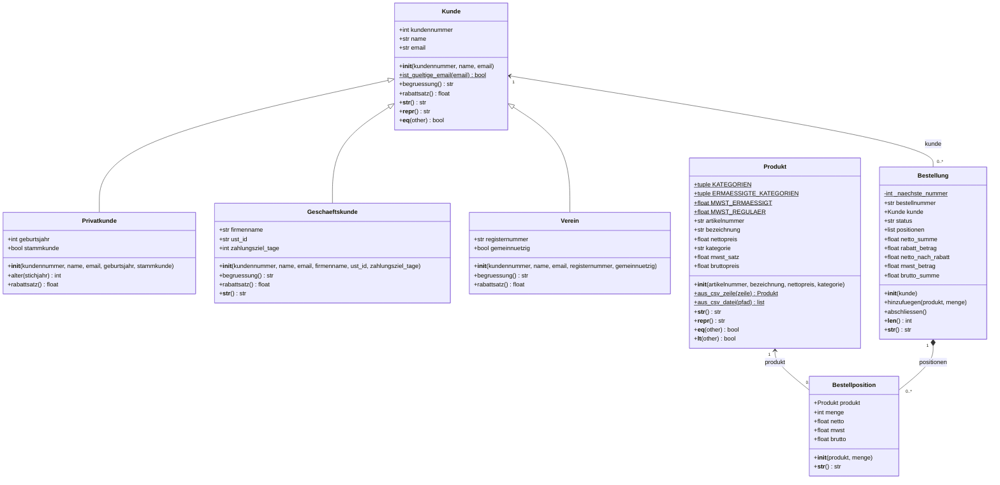

# Bestelo – Gruppe N

> Allgemeines Shopsystem in Python · Programmieren 2 (BW220) · HWG Ludwigshafen
> Die Aufgabenbeschreibung finden Sie auf OLAT.

Ein Satz zu Ihrem Projekt: Bestelo ist ein Konsolen-basiertes Bestellsystem, das es ermöglicht, Produkte aus einer CSV-Datei zu laden, verschiedene Kundentypen (Privatkunden, Geschäftskunden, Vereine) mit individuellen Rabatten zu verwalten und Bestellungen inklusive vollständigem Rechnungsdruck (Netto, Rabatt, MwSt., Brutto) abzuwickeln.


## Team

| Name | GitHub-Name | Rolle | Eigene Klassen / Dateien |
|------|-------------|-------|--------------------------|
| Altan Sarica      | @altan20sarica    | 1 · Teamleitung | `Kunde`, `Privatkunde` |
| Yakub Karakaya    | @yakubtaha-ai     | 2      | `Geschaeftskunde`, `Verein` |
| Mohammadmahdi Zandian | @Mehdixx007   | 3      | `Produkt`, `daten/produkte.csv` |
| Umutcan Yesil     | @Umutcanyesil     | 4      | `Bestellposition`, `Bestellung` |
| Yunus Apaydin     | @yunus0280        | 5      | Demo, README, UML, Integrationstest |

(Teamleitung bitte markieren.)

## So starten Sie

Im obersten Projektordner:

```bash
python -m pip install pytest   # einmalig
python -m pytest               # alle Tests ausführen
python -m bestelo              # Konsolen-Demo starten
```

## UML-Klassendiagramm




## Ideen für Phase 2

- Branche: Bürobedarf und Büroausstattung
- Features: - Filter nach Kategorie und Preis 
            - Lagerbestand anzeigen und bei einer Bestellung aktualisieren 
            - Bestellbestätigung ausgeben
