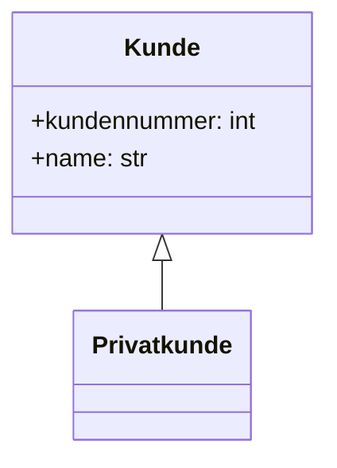

# Bestelo – Gruppe N

> Allgemeines Shopsystem in Python · Programmieren 2 (BW220) · HWG Ludwigshafen
> Die Aufgabenbeschreibung finden Sie auf OLAT.

Ein Satz zu Ihrem Projekt: …

## Team

| Name | GitHub-Name | Rolle | Eigene Klassen / Dateien |
|------|-------------|-------|--------------------------|
| …    | @…          | 1 · Teamleitung | `Kunde`, `Privatkunde` |
| …    | @…          | 2     | `Geschaeftskunde`, `Verein` |
| …    | @…          | 3     | `Produkt`, `daten/produkte.csv` |
| …    | @…          | 4     | `Bestellposition`, `Bestellung` |
| …    | @…          | 5     | Demo, README, UML, Integrationstest |

(Teamleitung bitte markieren.)

## So starten Sie

Im obersten Projektordner:

```bash
python -m pip install pytest   # einmalig
python -m pytest               # alle Tests ausführen
python -m bestelo              # Konsolen-Demo starten
```

## UML-Klassendiagramm



*(Person 5: vollständig ausbauen – alle 7 Klassen mit Eigenschaften, Methoden und Beziehungen.)*

## Ideen für Phase 2

- Branche: …
- Features: …
